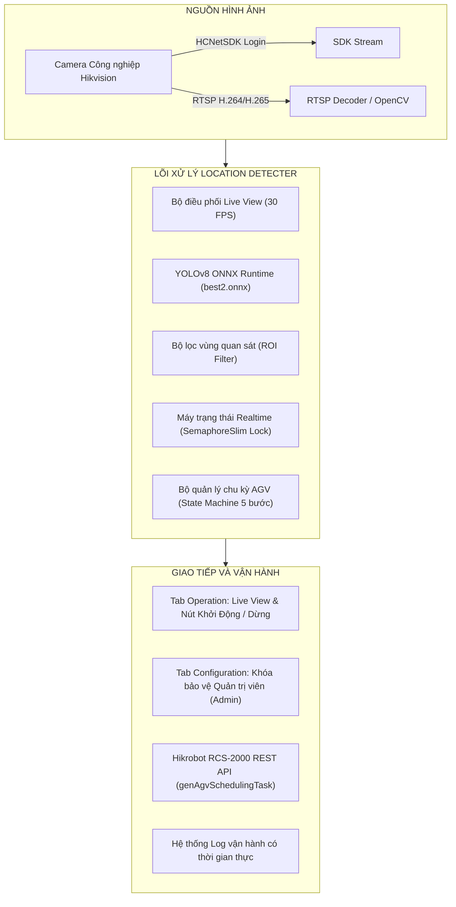

# TÀI LIỆU HƯỚNG DẪN TỔNG QUAN, CẤU HÌNH VÀ VẬN HÀNH HỆ THỐNG LOCATION DETECTER
> **Dự án:** Location Detecter (Pallet & Object Detection System with RCS-2000 AGV Integration)  
> **Phiên bản:** 2.0 (Bản hoàn thiện: Tự động khởi tạo, Bảo mật DPAPI, Điều khiển Realtime độc lập)  
> **Ngày cập nhật:** Tháng 11/2026  
> **Nền tảng:** .NET Framework 4.8 / WPF, OpenCvSharp4, ONNX Runtime, Hikvision SDK & RTSP, Hikrobot RCS-2000 REST API  

---

## MỤC LỤC
1. [TỔNG QUAN VÀ TỔNG KẾT TOÀN BỘ CHỨC NĂNG HỆ THỐNG](#1-tổng-quan-và-tổng-kết-toàn-bộ-chức-năng-hệ-thống)
   - [1.1. Kiến trúc tổng thể](#11-kiến-trúc-tổng-thể)
   - [1.2. Danh sách 6 phân hệ chức năng cốt lõi](#12-danh-sách-6-phân-hệ-chức-năng-cốt-lõi)
2. [CẤU TRÚC HỆ THỐNG VÀ HƯỚNG DẪN CẤU HÌNH (CONFIGURATION GUIDE)](#2-cấu-trúc-hệ-thống-và-hướng-dẫn-cấu-hình-configuration-guide)
   - [2.1. Cấu trúc thư mục & các tệp cấu hình JSON](#21-cấu-trúc-thư-mục--các-tệp-cấu-hình-json)
   - [2.2. Cơ chế phân quyền và Đăng nhập Quản trị viên (Admin Authentication)](#22-cơ-chế-phân-quyền-và-đăng-nhập-quản-trị-viên-admin-authentication)
   - [2.3. Hướng dẫn cấu hình kết nối Camera Hikvision & Mã hóa DPAPI](#23-hướng-dẫn-cấu-hình-kết-nối-camera-hikvision--mã-hóa-dpapi)
   - [2.4. Hướng dẫn nạp và cấu hình Model AI (best2.onnx)](#24-hướng-dẫn-nạp-và-cấu-hình-model-ai-best2onnx)
   - [2.5. Hướng dẫn vẽ, xóa và lưu vùng quan sát (ROI Settings)](#25-hướng-dẫn-vẽ-xóa-và-lưu-vùng-quan-sát-roi-settings)
   - [2.6. Hướng dẫn cấu hình vị trí gọi xe AGV (RCS Task Configuration)](#26-hướng-dẫn-cấu-hình-vị-trí-gọi-xe-agv-rcs-task-configuration)
3. [QUY TRÌNH HƯỚNG DẪN VẬN HÀNH (OPERATION MANUAL)](#3-quy-trình-hướng-dẫn-vận-hành-operation-manual)
   - [3.1. Bật nguồn và Khởi động hệ thống (Auto-Init)](#31-bật-nguồn-và-khởi-động-hệ-thống-auto-init)
   - [3.2. Bắt đầu nhận diện RealTime (Nút KHỞI ĐỘNG REALTIME)](#32-bắt-đầu-nhận-diện-realtime-nút-khởi-động-realtime)
   - [3.3. Giám sát luồng vận hành, AI và Chu kỳ gọi xe AGV tự động](#33-giám-sát-luồng-vận-hành-ai-và-chu-kỳ-gọi-xe-agv-tự-động)
   - [3.4. Tạm dừng RealTime (Nút DỪNG REALTIME)](#34-tạm-dừng-realtime-nút-dừng-realtime)
   - [3.5. Kết thúc ca và Đóng ứng dụng an toàn](#35-kết-thúc-ca-và-đóng-ứng-dụng-an-toàn)
4. [CÁC CƠ CHẾ AN TOÀN ĐÃ ĐƯỢC TỐI ƯU HÓA](#4-các-cơ-chế-an-toàn-đã-được-tối-ưu-hóa)
5. [HƯỚNG DẪN XỬ LÝ SỰ CỐ THƯỜNG GẶP (TROUBLESHOOTING)](#5-hướng-dẫn-xử-lý-sự-cố-thường-gặp-troubleshooting)

---

## 1. TỔNG QUAN VÀ TỔNG KẾT TOÀN BỘ CHỨC NĂNG HỆ THỐNG

### 1.1. Kiến trúc tổng thể
Hệ thống **LOCATION DETECTER** là giải pháp thị giác máy tính công nghiệp thông minh kết hợp điều khiển tự động hóa gọi xe tự hành AGV (Hikrobot RCS-2000). Phần mềm được xây dựng trên nền tảng **C# / WPF (.NET Framework 4.8)** với độ ổn định cao, đáp ứng môi trường nhà máy 24/7.



---

### 1.2. Danh sách 6 phân hệ chức năng cốt lõi

| Phân hệ | Chức năng chi tiết |
| :--- | :--- |
| **1. Kết nối Camera & Live Stream** | - Hỗ trợ đăng nhập thiết bị qua thư viện native C++ Hikvision SDK (`HCNetSDK.dll`).<br>- Thu nhận luồng hình ảnh độ phân giải cao qua giao thức RTSP độ trễ cực thấp.<br>- Tự động giải mã và hiển thị Live View mượt mà trên giao diện WPF (~30 FPS).<br>- Tự động phát hiện độ phân giải camera thực tế (Resolution).<br>- Hỗ trợ chụp và xuất ảnh Snapshot thủ công (`SAVE IMAGE`). |
| **2. Trí tuệ nhân tạo (YOLOv8)** | - Sử dụng thư viện `Microsoft.ML.OnnxRuntime` chạy suy luận trực tiếp trên CPU/GPU.<br>- Tự động tìm kiếm và nạp model tối ưu nhất: `best2.onnx` $\rightarrow$ `best1.onnx` $\rightarrow$ `best.onnx`.<br>- Phân loại chính xác các đối tượng: **Product / Box / Pallet** (thùng hàng) và **Human / Person** (người thao tác).<br>- Cho phép chạy nhận diện đơn lẻ (`SINGLE DETECTION`) hoặc nhận diện liên tục (`REAL TIME DETECTION`).<br>- Vẽ Bounding Box, nhãn lớp và tỷ lệ tin cậy trực tiếp lên ảnh kết quả. |
| **3. Quản lý vùng quan sát (ROI)** | - Cho phép người dùng dùng chuột vẽ vùng quan sát chữ nhật bất kỳ (`TẠO ROI`).<br>- Tự động chuyển đổi tọa độ chuột trên Canvas sang hệ tọa độ gốc của ảnh camera thực tế.<br>- **Ẩn nét vẽ thô trên màn hình Live**: Trả lại khung nhìn thông thoáng, chỉ hiển thị khung ROI viền vàng sau khi AI thực hiện detect.<br>- Lưu tọa độ vùng ROI vào tệp `roi_config.json` (`LƯU ROI`) để tự động khôi phục khi mở lại app. |
| **4. Tự động hóa gọi xe AGV (RCS-2000)** | - Tích hợp Client REST API chuẩn Hikrobot RCS-2000 (`genAgvSchedulingTask`).<br>- **Chu kỳ kích hoạt thông minh**: Tự động phát lệnh gọi AGV khi thỏa mãn đồng thời 2 điều kiện: *(1) Thùng hàng ổn định liên tục $\ge$ 2.0 giây* và *(2) Người thao tác đã rời đi $\ge$ 1.0 giây*.<br>- Chống gửi trùng lặp: Mỗi chu kỳ chỉ gửi duy nhất 1 Task, không bao giờ spam lệnh lên hệ thống AGV.<br>- Cho phép cấu hình linh hoạt mã vị trí Lấy hàng (`Pick-up Position`) và Trả hàng (`Drop-off Position`). |
| **5. Điều khiển RealTime an toàn** | - Không tự động chạy AI khi mở ứng dụng để bảo vệ tài nguyên.<br>- Vận hành đơn giản thông qua 2 nút chuyên dụng: **`KHỞI ĐỘNG REALTIME`** và **`DỪNG REALTIME`**.<br>- Khi dừng RealTime, camera vẫn duy trì kết nối và phát Live View bình thường.<br>- Sử dụng máy trạng thái kết hợp `SemaphoreSlim(1, 1)` chống hiện tượng Race Condition (bấm Start/Stop nhanh).<br>- Cơ chế độc quyền Render Owner loại bỏ triệt để hiện tượng nhấp nháy hoặc xung đột frame giữa Timer và AI. |
| **6. Bảo mật & Quản trị (Admin)** | - Toàn bộ chức năng cài đặt tại Tab Configuration được khóa mặc định (`IsEnabled = False`).<br>- Chỉ Quản trị viên sau khi đăng nhập thành công mới được phép xem và chỉnh sửa cấu hình.<br>- Mật khẩu Admin được mã hóa an toàn bằng thuật toán **Salt 16 bytes + SHA-256** (không lưu văn bản thuần).<br>- Mật khẩu kết nối Camera được mã hóa bằng **Windows DPAPI** cấp độ `LocalMachine` kết hợp Entropy bí mật.<br>- Không in mật khẩu hoặc thông tin nhạy cảm ra Log hay UI. |

---

## 2. CẤU TRÚC HỆ THỐNG VÀ HƯỚNG DẪN CẤU HÌNH (CONFIGURATION GUIDE)

### 2.1. Cấu trúc thư mục & các tệp cấu hình JSON
Ứng dụng thực thi độc lập từ thư mục `bin\x64\Release\` hoặc `bin\x64\Debug\`. Toàn bộ dữ liệu cấu hình được lưu cục bộ dưới định dạng JSON có cấu trúc:

```
PalletDetection/
├── PalletDetection.exe            # Tệp thực thi chính của hệ thống
├── PalletDetection.exe.config     # Cấu hình runtime .NET
├── best2.onnx (hoặc best1.onnx)   # Tệp Model AI YOLOv8 ONNX
├── logo.jpg                       # Logo doanh nghiệp hiển thị góc trên giao diện
├── camera_config.json             # Tệp lưu cấu hình Camera & Mật khẩu DPAPI
├── admin_config.json              # Tệp lưu Salt & Hash mật khẩu Admin
├── roi_config.json                # Tệp lưu tọa độ vùng ROI đã vẽ
├── rcs_config.json                # Tệp lưu thông số kết nối Hikrobot RCS-2000
├── HCNetSDK.dll                   # Thư viện Hikvision C++ Native SDK
├── PlayCtrl.dll                   # Thư viện giải mã video Hikvision
├── onnxruntime.dll                # Thư viện suy luận AI ONNX Runtime
└── HCNetSDKCom/                   # Thư mục plugin driver camera Hikvision
```

#### Chi tiết các tệp cấu hình:
1. **`camera_config.json`**:
   ```json
   {
     "ip": "192.168.1.64",
     "port": 8000,
     "username": "admin",
     "encryptedPassword": "AQAAANCMnd8BFdERjHoAwE/Cl+sBAAAA..."
   }
   ```
2. **`admin_config.json`**:
   ```json
   {
     "salt": "zbwypBBTT9RjFOqMsj4Zfg==",
     "passwordHash": "uCqf4CBhnwwpYn7dJrBerFykqtTceDQa+hpb+gpLHt0="
   }
   ```
3. **`roi_config.json`**:
   ```json
   {
     "hasRoi": true,
     "x": 350.0,
     "y": 180.0,
     "width": 640.0,
     "height": 480.0
   }
   ```
4. **`rcs_config.json`**:
   ```json
   {
     "baseUrl": "http://192.168.65.199:8181",
     "endpointPath": "/rcms/services/rest/hikRpcService/genAgvSchedulingTask",
     "tokenCode": "",
     "clientCode": "VISION_PALLET_APP",
     "timeoutSeconds": 5,
     "pickupPosition": "ETEK42",
     "dropoffPosition": "ETEK44"
   }
   ```

---

### 2.2. Cơ chế phân quyền và Đăng nhập Quản trị viên (Admin Authentication)
Để bảo vệ an toàn cho dây chuyền sản xuất, người vận hành thông thường chỉ được phép theo dõi Live View, xem Log và bấm Khởi Động/Dừng. Mọi thay đổi về thông số kỹ thuật đều yêu cầu đăng nhập Quản trị viên.

#### Quy trình đăng nhập Admin:
1. Mở giao diện phần mềm, chọn **Tab 2: Configuration**.
2. Tại khung **"XÁC THỰC QUẢN TRỊ VIÊN"** trên cùng:
   - Nhập mật khẩu quản trị vào ô **Mật khẩu Quản trị**.
   - *(Mật khẩu mặc định xuất xưởng là: `Etek@2026`)*.
   - Nhấn nút **`ĐĂNG NHẬP`**.
3. **Kết quả:**
   - Dòng trạng thái chuyển sang: `Trạng thái: Đã xác thực Quản trị viên (Được phép cấu hình)` (màu xanh lá cây).
   - Nút `ĐĂNG NHẬP` bị mờ, nút `ĐĂNG XUẤT` sáng lên.
   - Toàn bộ các vùng cấu hình Camera, Stream, Model, ROI và RCS được mở khóa hoàn toàn để thao tác.
4. **Đăng xuất bảo vệ:**
   - Sau khi cấu hình xong, nhấn nút **`ĐĂNG XUẤT`**.
   - Toàn bộ giao diện cấu hình tự động khóa lại (`IsEnabled = False`) để tránh người lạ vô tình sửa đổi.

---

### 2.3. Hướng dẫn cấu hình kết nối Camera Hikvision & Mã hóa DPAPI
1. Đăng nhập quyền Quản trị viên.
2. Di chuyển đến mục **CAMERA CONNECTION**:
   - **IP Address**: Nhập địa chỉ IP của Camera Hikvision (ví dụ: `192.168.1.64`).
   - **Port**: Cổng SDK thiết bị (mặc định: `8000`).
   - **Username**: Tài khoản camera (mặc định: `admin`).
   - **Password**: Mật khẩu camera (mặc định: `Etek@2026`).
3. **Kiểm tra kết nối thủ công:**
   - Nhấn nút **`CONNECT CAMERA`**.
   - Nếu thành công: Hộp thoại báo *"Camera Connected & Live Started"*, trạng thái camera chuyển thành `Camera : ONLINE` và hình ảnh hiển thị trên màn hình.
   - Nếu thất bại: Hệ thống báo lỗi chi tiết từ SDK, trạng thái chuyển `Camera : OFFLINE`.
4. **Lưu cấu hình & Mật khẩu mã hóa DPAPI:**
   - Nhấn nút **`LƯU CẤU HÌNH CAMERA (DPAPI)`**.
   - Mật khẩu sẽ được mã hóa bảo mật bằng công nghệ Windows DPAPI và lưu vào `camera_config.json`.
   - **Từ các lần khởi động sau, ứng dụng sẽ tự động kết nối camera mà không cần nhập lại.**

---

### 2.4. Hướng dẫn nạp và cấu hình Model AI (best2.onnx)
1. Đặt tệp model huấn luyện dạng `.onnx` vào cùng thư mục với phần mềm (đặt tên là `best2.onnx`).
2. Mặc định khi khởi động, phần mềm sẽ tự động quét và nạp file này.
3. Nếu muốn nạp model khác thủ công:
   - Vào **Tab Configuration** $\rightarrow$ Khu vực **AI MODEL & DETECTION**.
   - Nhấn nút **`CHỌN MODEL (.ONNX)`**.
   - Hộp thoại chọn tệp hiện lên $\rightarrow$ Trỏ tới tệp `.onnx` mong muốn và nhấn **Open**.
   - Khi nạp thành công: Dòng thông tin hiển thị `Model: [tên_file.onnx]` trên cả Tab Configuration và Tab Operation.

---

### 2.5. Hướng dẫn vẽ, xóa và lưu vùng quan sát (ROI Settings)
Vùng ROI giúp AI tập trung nhận diện thùng hàng trong một khu vực cố định (ví dụ: băng chuyền, vị trí đặt pallet), loại bỏ các vật thể gây nhiễu ngoài ý muốn.

1. **Vẽ vùng ROI mới:**
   - Vào **Tab Configuration** $\rightarrow$ Khu vực **ROI SETTINGS**.
   - Nhấn nút **`TẠO ROI`**. Con trỏ chuột chuyển thành hình dấu thập `+`.
   - Nhấn giữ chuột trái và kéo một hình chữ nhật trên khung hình camera Live View bao quanh vị trí cần giám sát, sau đó thả chuột.
   - Dòng trạng thái cập nhật tọa độ thực tế: `ROI: X=..., Y=..., W=..., H=...`.
   - *Lưu ý: Màn hình Live View sẽ tự động ẩn nét vẽ thô để đảm bảo tầm nhìn rõ ràng.*
2. **Kiểm tra vùng ROI vừa vẽ:**
   - Nhấn nút **`SINGLE DETECTION`**.
   - Trên ảnh kết quả, khung chữ nhật màu vàng nét đứt kèm nhãn chữ **"ROI"** sẽ được vẽ chính xác tại vị trí bạn vừa chọn.
3. **Lưu vùng ROI cố định:**
   - Nhấn nút **`LƯU ROI`**.
   - Tọa độ sẽ được ghi vào file `roi_config.json`. Các lần mở máy sau hệ thống sẽ tự động nạp lại đúng vị trí này mà không phải vẽ lại.
4. **Xóa vùng ROI:**
   - Nhấn nút **`XÓA ROI`**. Hệ thống sẽ chuyển về chế độ nhận diện trên toàn bộ khung hình camera (`ROI: Toàn khung hình`).

---

### 2.6. Hướng dẫn cấu hình vị trí gọi xe AGV (RCS Task Configuration)
1. Vào **Tab Configuration** $\rightarrow$ Khu vực **RCS TASK CONFIGURATION**:
   - **Pick-up Position**: Nhập mã điểm dừng lấy hàng của AGV (ví dụ: `ETEK42`).
   - **Drop-off Position**: Nhập mã điểm dừng trả hàng của AGV (ví dụ: `ETEK44`).
2. Nhấn nút **`SAVE RCS CONFIGURATION`**.
3. Thông số được cập nhật nóng vào bộ điều khiển chu kỳ và lưu vào tệp `rcs_config.json`.

---

## 3. QUY TRÌNH HƯỚNG DẪN VẬN HÀNH (OPERATION MANUAL)

### 3.1. Bật nguồn và Khởi động hệ thống (Auto-Init)
1. Đảm bảo Camera Hikvision đã được cấp nguồn và kết nối cùng lớp mạng LAN với máy tính điều khiển.
2. Khởi chạy phần mềm: Kích đúp vào biểu tượng **`PalletDetection.exe`** (hoặc shortcut trên Desktop).
3. **Quá trình tự động khởi tạo ngầm diễn ra:**
   - Nạp model AI: `best2.onnx`.
   - Khôi phục vùng quan sát: `roi_config.json`.
   - Giải mã DPAPI và tự động kết nối camera: `192.168.1.64:8000`.
   - Tự động bật Live View luồng video.
4. **Kiểm tra trạng thái sẵn sàng:**
   - Quan sát ô trạng thái tại **Tab Operation**:
     - Nếu hiển thị: **`HỆ THỐNG: SẴN SÀNG (READY)`** (chữ xanh lá cây) $\rightarrow$ Các điều kiện đều đạt, nút **`KHỞI ĐỘNG REALTIME`** được bật sáng.
     - Nếu hiển thị: **`HỆ THỐNG: CHƯA SẴN SÀNG (...)`** (chữ đỏ) $\rightarrow$ Kiểm tra lại dây mạng camera hoặc tệp model.

---

### 3.2. Bắt đầu nhận diện RealTime (Nút KHỞI ĐỘNG REALTIME)
1. Khi hệ thống ở trạng thái **READY**, người vận hành chỉ cần nhấn nút:
   $$\mathbf{KH\text{Ở}I\ \text{Đ}\text{Ộ}NG\ REALTIME}$$
2. **Diễn biến hệ thống:**
   - Trạng thái chuyển thành: **`HỆ THỐNG: ĐANG CHẠY REALTIME (RUNNING)`**.
   - Nút `KHỞI ĐỘNG REALTIME` bị vô hiệu hóa.
   - Nút **`DỪNG REALTIME`** (màu đỏ) sáng lên, sẵn sàng cho lệnh dừng.
   - Mô hình AI bắt đầu phân tích từng khung hình liên tục: đóng khung xanh các thùng hàng (Product) và người (Human).

---

### 3.3. Giám sát luồng vận hành, AI và Chu kỳ gọi xe AGV tự động
Người vận hành theo dõi trực tiếp tại **Tab Operation**:

1. **Khung Live View trung tâm:**
   - Hiển thị video camera thời gian thực kèm các Bounding Box nhận diện.
   - Vùng ROI được vẽ bằng khung viền màu vàng nét đứt.
2. **Khung thông tin hệ thống (SYSTEM SUMMARY):**
   - **Model**: Tên file model đang nạp.
   - **ROI**: Tọa độ góc và kích thước vùng quan sát.
   - **Nhận diện**: Số lượng đối tượng đang phát hiện trong khung hình (ví dụ: `Realtime: 2 đối tượng (product: 2)`).
   - **RCS**: Trạng thái chu kỳ gọi xe AGV:
     - `Chờ thùng hàng xuất hiện...`: Chưa có thùng hàng trong ROI.
     - `Đang ổn định thùng hàng (1.2s / 2.0s)`: Thùng đang được đặt vào vị trí.
     - `Chờ người thao tác rời đi (0.5s / 1.0s)`: Thùng đã ổn định, đang đợi công nhân lùi ra xa.
     - `Đã gửi Task thành công (TaskCode: AGV_...)`: Đã gửi lệnh gọi xe thành công đến máy chủ RCS.
     - `Chờ thùng hàng rời đi để reset chu kỳ...`: Chờ AGV đến lấy thùng đi để sẵn sàng cho chu kỳ tiếp theo.
3. **Nhật ký vận hành (OPERATION LOGS):**
   - Mọi sự kiện phát hiện, kết nối, mã lỗi HTTP và phản hồi từ hệ sinh thái đều được ghi nhật ký kèm dấu thời gian `[HH:mm:ss]`.
   - Để xóa màn hình nhật ký, bấm nút **`XÓA NHẬT KÝ (CLEAR LOG)`**.

---

### 3.4. Tạm dừng RealTime (Nút DỪNG REALTIME)
Khi cần bảo trì, sắp xếp lại hàng hóa hoặc tạm ngừng ca làm việc:
1. Nhấn nút:
   $$\mathbf{D\text{Ừ}NG\ REALTIME}$$
2. **Diễn biến hệ thống:**
   - Tác vụ AI ngưng suy luận an toàn trong vòng dưới 1 giây.
   - Trạng thái trả về: **`HỆ THỐNG: SẴN SÀNG (READY)`**.
   - **Camera vẫn duy trì kết nối và Live View vẫn hiển thị liên tục**, giúp người vận hành tiếp tục quan sát hiện trường.
   - Nút `KHỞI ĐỘNG REALTIME` sáng trở lại.

---

### 3.5. Kết thúc ca và Đóng ứng dụng an toàn
1. Người vận hành chỉ cần nhấn nút dấu **`X`** ở góc trên bên phải cửa sổ.
2. **Quy trình giải phóng tài nguyên tự động (Safe Cleanup):**
   - Tự động hủy vòng lặp RealTime (nếu đang chạy).
   - Tự động dừng luồng phát Live View và ngắt kết nối Camera SDK an toàn.
   - Tự động giải phóng bộ nhớ Model AI ONNX Runtime.
   - Cửa sổ đóng lại sạch sẽ, không để lại tiến trình chạy ngầm (chống rò rỉ RAM).

---

## 4. CÁC CƠ CHẾ AN TOÀN ĐÃ ĐƯỢC TỐI ƯU HÓA

| Hiện tượng nguy cơ | Cơ chế bảo vệ trong mã nguồn |
| :--- | :--- |
| **Bấm Start/Stop liên tục (Race Condition)** | Khóa bằng `SemaphoreSlim(1, 1)` kết hợp máy trạng thái 4 nấc (`Stopped` $\rightarrow$ `Starting` $\rightarrow$ `Running` $\rightarrow$ `Stopping`). Khi đang chuyển trạng thái, cả 2 nút Start và Stop đều bị khóa, ngăn chặn triệt để việc tạo nhiều tiến trình AI chạy chồng lấn. |
| **Báo trạng thái ảo (False Status)** | Hệ thống không bao giờ báo `RUNNING` trước khi suy luận. Trạng thái `RUNNING` chỉ được kích hoạt từ bên trong luồng nền sau khi frame đầu tiên phân tích thành công. Hệ thống chỉ báo `READY` khi cả Camera và Model đều trực tuyến. |
| **Xung đột khung hình Live View (Nhấp nháy)** | Áp dụng cờ độc quyền `_renderOwner` (0: Tự do, 1: LiveTimer, 2: RealTime). Khi RealTime hoạt động, Timer hiển thị thường sẽ tự động nhường quyền hoàn toàn, loại bỏ 100% xung đột luồng và hiện tượng nhấp nháy hình ảnh. |
| **Treo ứng dụng khi dừng (Deadlock / Freezing)** | Loại bỏ hoàn toàn các hàm đồng bộ chặn luồng UI như `Task.Wait()`. Thay vào đó, áp dụng `await Task.WhenAny(_realTimeTask, Task.Delay(3000))` bất đồng bộ, đảm bảo ứng dụng phản hồi mượt mà ngay cả khi mạng bị ngắt đột ngột. |
| **Lỗi giải mã DPAPI khi đổi máy trạm** | Mã hóa bằng phạm vi `LocalMachine` kèm khóa Entropy bảo vệ. Nếu chuyển phần mềm sang máy tính khác chưa được mã hóa lại, hệ thống tự động fallback an toàn về mật khẩu xuất xưởng `Etek@2026`, không làm crash ứng dụng. |
| **Hỏng tệp cấu hình JSON** | Khi tệp cấu hình bị lỗi cú pháp do mất điện đột ngột, hàm `LoadOrCreateDefault()` sẽ tự động đổi tên tệp hỏng thành `.corrupt_bak_[thời_gian]` để bảo toàn dữ liệu gốc, sau đó tự tái tạo cấu hình chuẩn mới. |

---

## 5. HƯỚNG DẪN XỬ LÝ SỰ CỐ THƯỜNG GẶP (TROUBLESHOOTING)

### 5.1. Camera báo `OFFLINE` hoặc không tự kết nối khi mở app
- **Nguyên nhân 1:** Dây mạng camera bị lỏng hoặc switch mạng chưa bật nguồn.
  - *Cách xử lý:* Kiểm tra đèn cổng LAN trên camera. Dùng lệnh `ping 192.168.1.64` từ máy tính để kiểm tra thông mạng.
- **Nguyên nhân 2:** Camera bị đổi mật khẩu hoặc đổi địa chỉ IP.
  - *Cách xử lý:* Đăng nhập quyền Quản trị viên $\rightarrow$ Vào **Tab Configuration** $\rightarrow$ Cập nhật lại IP và Mật khẩu mới $\rightarrow$ Bấm `CONNECT CAMERA` $\rightarrow$ Bấm `LƯU CẤU HÌNH CAMERA (DPAPI)`.

### 5.2. Hệ thống báo `HỆ THỐNG: CHƯA SẴN SÀNG (Chưa nạp Model AI)`
- **Nguyên nhân:** Thiếu file `best2.onnx` hoặc `best1.onnx` trong thư mục chương trình.
  - *Cách xử lý:* Copy file `best2.onnx` vào thư mục chứa `PalletDetection.exe`, hoặc đăng nhập Admin rồi bấm nút `CHỌN MODEL (.ONNX)` để trỏ đến tệp model trên máy.

### 5.3. Không gửi được Task đến hệ thống Hikrobot RCS-2000
- **Nguyên nhân 1:** Máy chủ RCS-2000 (hoặc máy ảo Mockoon) chưa được bật.
  - *Cách xử lý:* Kiểm tra kết nối đến IP máy chủ RCS (`http://192.168.65.199:8181`). Đảm bảo phần mềm Mockoon hoặc Server RCS đang ở trạng thái chạy.
- **Nguyên nhân 2:** Sai mã vị trí Pick-up hoặc Drop-off.
  - *Cách xử lý:* Vào **Tab Configuration** $\rightarrow$ Kiểm tra mã vị trí tại mục **RCS TASK CONFIGURATION** (ví dụ: `ETEK42`, `ETEK44`). Nhấn `SAVE RCS CONFIGURATION` sau khi sửa.
- **Nguyên nhân 3:** Tính năng tự động gửi đang bị tắt.
  - *Cách xử lý:* Kiểm tra ô tích chọn **"Tự động gửi Task RCS"** trên Tab Configuration xem đã được đánh dấu tích `[v]` hay chưa.

### 5.4. Quên mật khẩu Quản trị viên (Admin)
- **Cách xử lý:** 
  1. Đóng ứng dụng `PalletDetection.exe`.
  2. Xóa tệp `admin_config.json` trong thư mục phần mềm.
  3. Mở lại phần mềm. Hệ thống sẽ tự động khởi tạo lại mật khẩu quản trị viên mặc định là: **`Etek@2026`**.

---
*Tài liệu được biên soạn đồng bộ cho Hệ thống LOCATION DETECTER (PalletDetection). Mọi vướng mắc kỹ thuật vui lòng liên hệ bộ phận Kỹ thuật Tự động hóa ETEK.*

