# LOCATION DETECTER - BÀI THUYẾT TRÌNH GIỚI THIỆU DỰ ÁN & VẬN HÀNH TRẠM
> **Đơn vị phát triển:** CÔNG TY CỔ PHẦN GIẢI PHÁP TỰ ĐỘNG HÓA ETEK (ETEK Automation Solutions JSC)  
> **Template thiết kế:** Chuẩn nhận diện thương hiệu ETEK (`Template Giải pháp Vision V3.pptx`)  
> **Hình ảnh minh họa:** Nhúng trực tiếp 100% ảnh chụp thực tế trạm từ `D:\work\SLIDE_ANH` & Sơ đồ kỹ thuật  
> **Đối tượng hướng đến:** Khách hàng doanh nghiệp, Quản lý nhà máy thông minh & Đơn vị tích hợp  
> **Phong cách:** Corporate Industrial Technology, trực quan, thân thiện, tập trung giá trị kinh tế và an toàn lao động  
> **Tỷ lệ trình chiếu:** 16:9 | Tệp slide hoàn chỉnh: `LOCATION_DETECTER_PRESENTATION.pptx`  

---

## TỔNG QUAN 18 SLIDE (ĐỒNG BỘ TEMPLATE ETEK VÀ HÌNH ẢNH THỰC TẾ)

```mermaid
flowchart TD
    subgraph P1 ["PHẦN I: GIỚI THIỆU TỔNG QUAN (Slide 1 - 5)"]
        S1["Slide 1: Trang bìa ETEK Warehouse - Tên GP & Đơn vị phát triển"]
        S2["Slide 2: Bối cảnh nhà máy & Nhu cầu tự động hóa gọi xe AGV"]
        S3["Slide 3: Giải pháp Location Detecter: 'Mắt thần' tự động"]
        S4["Slide 4: Cấu trúc hệ thống trạm (Kèm ảnh trạm thực tế)"]
        S5["Slide 5: Nguyên lý hoạt động trực quan trong 5 bước"]
    end

    subgraph P2 ["PHẦN II: CÔNG NGHỆ & VAI TRÒ SMART FACTORY (Slide 6 - 9)"]
        S6["Slide 6: Công nghệ AI YOLOv8 (Ảnh thật nhận diện Product 0.86)"]
        S7["Slide 7: Công nghệ ROI & An toàn kép (Ảnh cấu hình ROI)"]
        S8["Slide 8: Vai trò kết nối RCS-2000 (Ảnh log gửi lệnh HTTP POST)"]
        S9["Slide 9: Vị trí của trạm trong hệ sinh thái Smart Factory"]
    end

    subgraph P3 ["PHẦN III: CÁC PHƯƠNG ÁN ỨNG DỤNG THỰC TẾ (Slide 10 - 11)"]
        S10["Slide 10: 6 Phương án ứng dụng (Kèm 6 ảnh minh họa riêng biệt)"]
        S11["Slide 11: Dự án thực tế: Đóng gói sang kho (Sơ đồ mặt bằng 85m)"]
    end

    subgraph P4 ["PHẦN IV: HƯỚNG DẪN SỬ DỤNG VÀ VẬN HÀNH (Slide 12 - 18)"]
        S12["Slide 12: Tổng quan giao diện phần mềm (Ảnh toàn màn hình thực tế)"]
        S13["Slide 13: Cấu hình hệ thống Administrator (Ảnh xác thực & điểm AGV)"]
        S14["Slide 14: Khởi động trạm Operator (Ảnh trạng thái Sẵn Sàng READY)"]
        S15["Slide 15: Vận hành nhận diện AI (Ảnh Live View Product & Counter)"]
        S16["Slide 16: Tự động phát lệnh gọi xe RCS (Ảnh log & trạng thái tím)"]
        S17["Slide 17: Quy trình dừng trạm & Xử lý 3 tình huống thường gặp"]
        S18["Slide 18: Tổng kết giá trị & Thông tin liên hệ ETEK JSC (Q&A)"]
    end

    P1 --> P2 --> P3 --> P4
```

---

# CHI TIẾT NỘI DUNG 18 SLIDE (BẢN DIỄN GIẢI THÂN THIỆN)

---

### SLIDE 1: TRANG BÌA
- **Tiêu đề chính:** LOCATION DETECTER
- **Tiêu đề phụ:** Trạm Camera Thông Minh Tự Động Nhận Biết Hàng Hóa & Tự Động Gọi Xe Tự Hành AGV Đến Chuyển Hàng
- **Thông điệp ngắn gọn:** Tự động 100% • Không cần bấm nút • Bảo đảm an toàn tuyệt đối • Xe tự đến lấy hàng
- **Đơn vị phát triển:** ETEK Automation Solutions
- **Kịch bản lời thoại (Speaker Notes):**
  > "Kính chào quý vị! Hôm nay chúng tôi xin giới thiệu giải pháp **Location Detecter** – hiểu đơn giản đây là một 'mắt thần' camera thông minh gắn phía trên điểm để hàng. Khi công nhân đóng gói xong và bước ra ngoài, camera sẽ tự nhìn thấy và tự gọi xe tự hành AGV đến chở hàng đi, công nhân không cần bấm bất kỳ nút nào, vừa tiện lợi vừa an toàn tuyệt đối."

---

### SLIDE 2: NHỮNG KHÓ KHĂN THỰC TẾ TRONG NHÀ MÁY
- **Tiêu đề:** Những Khó Khăn Thực Tế Khi Chuyển Hàng Trong Nhà Máy
- **4 Vấn đề thường gặp:**
  1. **Phải bấm nút thủ công:** Công nhân đóng gói xong phải đi tìm nút bấm hoặc máy quét mã để gọi xe. Lúc bận rộn rất dễ quên, khiến hàng hóa nằm chờ ùn tắc.
  2. **Xe AGV đến lấy hàng hụt:** Xe tự hành chạy đến nơi thì hàng chưa xong, hoặc chạy vào vị trí không có hàng, gây lãng phí pin và nghẽn đường.
  3. **Nguy cơ va chạm người - xe:** Xe tự hành tiến vào khi công nhân chưa quấn màng co xong hoặc đang đứng gần bàn hàng, tiềm ẩn nguy cơ tai nạn.
  4. **Cảm biến cũ rất hay báo sai:** Mắt cảm biến quang gắn dưới sàn rất dễ bám bụi bẩn, ai đi qua cũng báo nhầm, phải lau chùi liên tục.
- **Hậu quả:** Hàng hóa ứ đọng, giảm năng suất chuyền, xe chạy không tối ưu và người quản lý luôn lo lắng về an toàn.
- **Kịch bản lời thoại (Speaker Notes):**
  > "Dù nhà máy đã mua xe tự hành AGV rất hiện đại, nhưng khâu phát lệnh gọi xe hiện nay vẫn phụ thuộc vào người công nhân. Nhiều khi công nhân mải làm quên bấm nút, hàng nằm chờ cả tiếng đồng hồ; hoặc xe AGV tự đi đến khi công nhân chưa kịp rút tay ra rất nguy hiểm. Các cảm biến quang cũ dưới sàn thì bụi bẩn là báo sai liên tục."

---

### SLIDE 3: GIẢI PHÁP LOCATION DETECTER
- **Tiêu đề:** Giải Pháp Location Detecter: 'Mắt Thần' Gọi Xe Tự Động
- **Khái niệm đơn giản:** Một chiếc camera thông minh treo phía trên bàn để hàng, tự động làm thay công việc của con người:
  1. **Tự động nhận biết hàng:** Thùng hàng hay pallet đặt vào là camera nhận ra ngay, không cần bấm nút.
  2. **Canh chừng an toàn:** Kiểm tra xem người đã rút tay và lùi ra xa chưa. Người còn đứng gần thì xe tuyệt đối không được đến.
  3. **Tự gọi xe tự hành:** Khi đủ 2 điều kiện 'Hàng sẵn sàng' và 'Người an toàn', máy tính tự động gọi xe đến chở đi.
- **Hiệu quả rõ rệt:** 0 thao tác bấm nút | Giảm 85% thời gian hàng chờ | 100% an toàn lao động | Bật máy là tự chạy.
- **Kịch bản lời thoại (Speaker Notes):**
  > "Giải pháp này cực kỳ trực quan: Chúng ta gắn 1 chiếc camera phía trên bàn con lăn đóng gói. Khẩu hiệu vận hành là: 'Hàng vào vị trí - Người bước ra ngoài - Xe tự đến lấy'. Công nhân hoàn toàn không phải bấm nút gì cả, giúp họ rảnh tay tập trung đóng gói, năng suất tăng vọt và an toàn 100%."

---

### SLIDE 4: HỆ THỐNG BAO GỒM NHỮNG GÌ? (RẤT GỌN NHẸ)
- **Tiêu đề:** Hệ Thống Bao Gồm Những Gì? (Rất Gọn Nhẹ & Dễ Lắp Đặt)
- **5 Thành phần dễ hiểu:**
  1. **Mắt camera treo trên cao:** Gắn trên cột hoặc xà nhà cao khoảng 3 mét, nhìn thẳng xuống bàn để hàng. Vỏ kim loại chống bụi nước bền bỉ.
  2. **Máy tính nhỏ gọn:** Đặt gần bàn thao tác, tự chạy phần mềm thông minh, không cần nối mạng internet ra ngoài, bảo mật tuyệt đối.
  3. **Màn hình trực quan:** Đặt trước mặt công nhân để quan sát trực tiếp hình ảnh và chữ 'SẴN SÀNG' màu xanh rất dễ hiểu.
  4. **Phần mềm thông minh:** Tự nhận biết đâu là thùng hàng, đâu là bàn tay hay người công nhân để bảo đảm an toàn.
  5. **Dây mạng nối xe AGV:** Một sợi dây mạng nối từ máy tính tới hệ thống điều khiển xe AGV để phát lệnh điều xe.
- **Kịch bản lời thoại (Speaker Notes):**
  > "Hệ thống cực kỳ gọn gàng. Nhà máy không cần phải đào sàn đi dây phức tạp hay gắn cảm biến cồng kềnh. Chỉ cần 1 chiếc camera gắn trên cao nhìn xuống, nối về 1 máy tính nhỏ và 1 màn hình. Toàn bộ thiết bị đều dùng chuẩn công nghiệp bền bỉ, chạy liên tục cả ngày lẫn đêm."

---

### SLIDE 5: CÁCH THỨC HOẠT ĐỘNG TRONG 5 BƯỚC
- **Tiêu đề:** Cách Thức Hoạt Động (Đơn Giản Trong 5 Bước)
- **Quy trình 5 bước:**
  - **Bước 1:** Camera liên tục quan sát vị trí bàn để hàng, truyền hình ảnh trực tiếp lên màn hình.
  - **Bước 2:** Camera chỉ nhìn vào đúng ô để hàng đã quy định, ai đi qua đi lại bên ngoài đều được bỏ qua.
  - **Bước 3:** Hệ thống canh chừng 2 điều kiện an toàn: Thùng hàng nằm yên 2 giây và người công nhân đã bước ra xa 1 giây.
  - **Bước 4:** Khi đủ an toàn, hệ thống tự động phát tín hiệu qua mạng gọi xe AGV đến bàn hàng.
  - **Bước 5:** Xe đến chở hàng đi. Sau khi bàn hàng trống, hệ thống tự sẵn sàng đón đợt hàng tiếp theo.
- **Khóa thông minh:** Mỗi kiện hàng chỉ gọi xe đúng 1 lần duy nhất, tuyệt đối không bao giờ gọi nhầm nhiều xe đến cùng lúc gây tắc đường.
- **Kịch bản lời thoại (Speaker Notes):**
  > "Quy trình này hoàn toàn tự động từ đầu đến cuối. Công nhân chỉ việc đẩy thùng hàng vào bàn và lùi lại. Hệ thống kiểm tra thấy hàng nằm yên 2 giây và người lùi ra xa 1 giây là xe tự chạy đến. Sau khi xe chở đi xong, hệ thống tự động đón đợt hàng tiếp theo mà không cần ai cài đặt lại."

---

### SLIDE 6: CAMERA AI THÔNG MINH NHÌN ĐƯỢC NHỮNG GÌ?
- **Tiêu đề:** Camera AI Thông Minh: Nhìn Chuẩn Xác & Phân Biệt Rõ Ràng
- **Đặc tính nổi bật:**
  - **Phân biệt rõ người và hàng:** Tự phân biệt được: Đâu là thùng hàng, đâu là pallet gỗ, và đâu là bàn tay hay người công nhân. Dù thùng to hay nhỏ đều nhận diện chính xác 100%.
  - **Không sợ ánh sáng thay đổi:** Trời nắng, trời tối bật đèn tuýp hay có bóng đổ... camera đều tự động nhìn rõ, không bị lừa bởi bóng người đi qua.
  - **Tốc độ tức thì (30 lần/giây):** Vừa đặt thùng hàng vào là máy nhận ra ngay trong tích tắc (chưa tới 0.03 giây).
- **Kịch bản lời thoại (Speaker Notes):**
  > "Điểm mạnh của công nghệ này là camera có trí tuệ nhân tạo như mắt người. Nó nhìn thấy và hiểu được: Đây là thùng hàng, còn đây là bàn tay của công nhân. Do đó, nó không bao giờ bị đánh lừa bởi một chiếc bóng hay ai đó đi lướt qua."

---

### SLIDE 7: KHOANH VÙNG ĐỂ HÀNG & QUY TẮC AN TOÀN
- **Tiêu đề:** Khoanh Vùng Nhận Diện & Cơ Chế Canh Chừng An Toàn
- **Khoanh vùng để hàng (ROI):** Dùng chuột vẽ 1 ô chữ nhật bao quanh đúng mặt bàn để hàng. Ai đi lại ngoài ô này đều bị bỏ qua; cài 1 lần là máy tự nhớ mãi mãi.
- **Quy tắc an toàn nghiêm ngặt:**
  - *Đang xếp hàng vào bàn:* Máy tính báo: **CHƯA ĐƯỢC ĐI** (Đang đợi hàng đặt ngay ngắn).
  - *Hàng xếp xong nhưng người chưa đi:* Máy tính báo: **CHỜ AN TOÀN** (Bảo vệ người 100%, xe không được đến).
  - *Người quay lại sờ vào hàng:* Máy tính báo: **TÍNH LẠI TỪ ĐẦU** (Đồng hồ đếm an toàn lập tức trả về 0).
  - *Hàng ngay ngắn & Người đã bước ra:* Máy tính báo: **ĐỦ AN TOÀN - GỌI XE NGAY!**
- **Kịch bản lời thoại (Speaker Notes):**
  > "Quý vị hoàn toàn yên tâm về vấn đề an toàn. Chúng tôi lập trình quy tắc rất nghiêm ngặt: Thùng hàng phải nằm yên đúng 2 giây, và công nhân phải rút lui khỏi vùng đó đủ 1 giây. Nếu công nhân quay lại chạm tay vào hàng, hệ thống lập tức đếm lại từ đầu. Xe AGV không bao giờ đến gần khi con người chưa an toàn."

---

### SLIDE 8: CÁCH TRẠM KẾT NỐI VÀ GỌI XE AGV
- **Tiêu đề:** Cách Trạm Kết Nối Và Báo Cho Xe AGV Đến Lấy Hàng
- **Giao tiếp tự động qua mạng nội bộ:**
  - Máy tính nối thẳng với máy chủ điều khiển xe tự hành qua dây mạng LAN nội bộ.
  - Trạm tự báo: *"Tại bàn đóng gói ETEK42 đã có hàng an toàn, hãy chở đến cửa kho ETEK44"*.
  - Máy chủ nhận lệnh và điều xe AGV gần nhất xuất phát ngay lập tức.
  - Màn hình hiện mã xe đang đến nhận hàng để công nhân yên tâm.
- **Minh bạch với khách hàng:** Trạm chịu trách nhiệm nhận biết hàng và gọi xe thành công. Sau khi xe nhận lệnh, đường đi của xe trên sàn xưởng sẽ do hệ thống bản đồ xe tự hành dẫn đường.
- **Kịch bản lời thoại (Speaker Notes):**
  > "Cách thức làm việc rất thông minh: Máy tính của trạm kết nối thẳng với máy chủ điều hành xe AGV bằng dây mạng. Khi đủ điều kiện, trạm tự động báo cho máy chủ biết và điều xe đến bốc hàng. Quá trình này diễn ra chỉ trong nửa giây."

---

### SLIDE 9: VỊ TRÍ CỦA TRẠM TRONG TOÀN BỘ NHÀ MÁY
- **Tiêu đề:** Vị Trí Của Trạm Trong Toàn Bộ Nhà Máy
- **Cầu nối giữa con người và hệ thống tự động:** Trạm đứng ngay giữa hiện trường đóng gói và đội xe tự hành, biến hành động của con người thành tín hiệu điều khiển xe tức thời.
- **Bảo toàn đầu tư cho tương lai:**
  - *Hôm nay:* Có ngay giải pháp gọi xe tự động không nút bấm, an toàn tuyệt đối.
  - *Tương lai:* Khi nhà máy mở rộng, trạm sẵn sàng lắp thêm mắt đọc mã vạch QR/Barcode và nối dữ liệu lên phần mềm quản lý kho tổng.
- **Kịch bản lời thoại (Speaker Notes):**
  > "Location Detecter giống như một người điều phối viên thông minh đứng tại hiện trường. Nó nhìn thấy công nhân làm việc và báo tin ngay cho hệ thống xe tự hành. Đầu tư trạm hôm nay là quý vị có ngay giải pháp giải quyết ách tắc hàng hóa, và mai sau khi mở rộng nhà máy, trạm vẫn hoàn toàn nâng cấp được thêm các tính năng như quét mã vạch."

---

### SLIDE 10: 6 VỊ TRÍ LẮP ĐẶT TRONG NHÀ MÁY
- **Tiêu đề:** 6 Phương Án Ứng Dụng Điển Hình Của Location Detecter
- **Mỗi phương án có 1 hình ảnh minh họa kỹ thuật riêng biệt:**
  1. *Cấp Liệu Cho Dây Chuyền (Ảnh `app1_infeed.png`):* Gắn camera phía trên khay phôi đầu vào. Khi khay hết hàng, trạm tự gọi xe AGV mang thùng vật tư mới đến tiếp tế.
  2. *Thu Gom Pallet Cuối Chuyền (Ảnh `app2_pallet_takeaway.png`):* Gắn trên bàn con lăn quấn màng co. Pallet đầy $\rightarrow$ trạm tự phát hiện và gọi AGV kéo vào kho.
  3. *Vận Chuyển Bán Thành Phẩm (Ảnh `app3_wip_transfer.png`):* Thùng hàng xong công đoạn dập cơ khí được trạm nhận biết để gọi AGV chở sang xưởng lắp ráp tiếp theo.
  4. *Giám Sát Ô Tập Kết Tạm (Ảnh `app4_buffer_staging.png`):* Giám sát các ô đệm kẻ vạch vàng sàn xưởng. Khi hàng được đặt vào ô, AGV tự động tới dọn sạch mặt sàn.
  5. *Điều Phối Hàng Giữa Các Khu (Ảnh `app5_cross_cleanroom.png`):* Vận chuyển hàng xuyên qua phòng sạch Air-Shower, hạn chế công nhân đi lại tránh mang bụi bẩn vào xưởng.
  6. *Tự Động Hóa Kho Hàng (Ảnh `app6_warehouse_dock.png`):* Xe nâng đặt pallet lên bàn đón, trạm nhận biết và gọi AGV nâng đưa sâu vào các kệ kho cao tầng.
- **Kịch bản lời thoại (Speaker Notes):**
  > "Trạm có thể đặt ở bất cứ nơi nào trong nhà máy có nhu cầu gọi xe: Từ đầu chuyền cấp vật tư, cuối chuyền gom pallet, chuyển hàng giữa các xưởng, cho đến việc dọn các ô tập kết tạm hay đưa hàng vào kho. Mỗi phương án đều có 1 hình ảnh minh họa riêng biệt rất trực quan."

---

### SLIDE 11: VÍ DỤ TÍCH HỢP TRONG DỰ ÁN NHÀ MÁY THỰC TẾ
- **Tiêu đề:** Ví Dụ Tích Hợp Dự Án Thực Tế: Đóng Gói Sang Kho Thành Phẩm
- **Ghi chú bắt buộc:** *Lưu ý: Đây là kịch bản thiết kế mẫu đề xuất điển hình dựa trên yêu cầu thực tế của nhà máy sản xuất linh kiện & hàng tiêu dùng.*
- **Bố cục trực quan:**
  - **Bên trái (Sơ đồ mặt bằng - Ảnh `scenario_packaging_to_warehouse.png`):**
    - Vị trí Trạm Location Detecter tại bàn con lăn cuối chuyền đóng gói (Điểm đón hàng `ETEK42`).
    - Lối di chuyển 85m của xe AGV từ bàn đóng gói xuyên qua hành lang xưởng.
    - Điểm trả hàng tại cửa kho thành phẩm (Điểm trả hàng `ETEK44`).
  - **Bên phải (Nội dung phân tích 5 khối thông tin cốt lõi):**
    1. *Bối Cảnh & Vấn Đề:* Khu đóng gói đạt sản lượng 45 pallet/giờ, kho cách 85m. Công nhân phải bỏ dở tay việc để đi bấm chuông gọi xe; nhiều khi quên bấm làm hàng ứ đọng cản trở lối đi, nguy cơ va quẹt cao.
    2. *Vị Trí Lắp Trạm:* Treo 1 camera Location Detecter cao 3.2m trên xà trần, chiếu thẳng vào bàn con lăn cuối chuyền đóng gói (`ETEK42`).
    3. *Kết Nối Điều Phối Xe RCS-2000:* Trạm kết nối máy chủ RCS-2000 bằng cáp mạng LAN. Tự động gửi yêu cầu gọi xe đón hàng tại `ETEK42` chuyển đến `ETEK44`.
    4. *Luồng Vận Hành 100% Tự Động:* Công nhân đóng gói xong đẩy pallet vào bàn $\rightarrow$ bước lùi ra ngoài an toàn $\rightarrow$ Trạm tự động xác nhận và phát lệnh $\rightarrow$ Xe AGV số 03 lập tức đến bốc hàng chở 85m về kho.
    5. *Lợi Ích Dự Kiến Đạt Được:*
       - Năng suất đóng gói tăng ngay **25%** do công nhân chuyên tâm làm việc.
       - Hàng hóa chờ xe giảm từ 8 phút xuống **dưới 45 giây**.
       - Đảm bảo an toàn **100%** không lo va chạm.
       - Hoàn vốn đầu tư chỉ trong vòng **6 - 8 tháng**.
- **Kịch bản lời thoại (Speaker Notes):**
  > "Đây là kịch bản thiết kế mẫu trực quan nhất để khách hàng hình dung toàn bộ hệ thống hoạt động: Bàn đóng gói ETEK42 được camera quan sát từ trên cao, khi pallet sẵn sàng và công nhân an toàn, trạm tự gọi xe AGV chở thẳng 85 mét về cửa kho ETEK44. Công nhân hoàn toàn không phải bấm nút hay chạm tay vào máy tính."

---

### SLIDE 12: GIAO DIỆN PHẦN MỀM: TRỰC QUAN & DỄ DÙNG
- **Tiêu đề:** Giao Diện Phần Mềm: Trực Quan, Dễ Dùng & Rõ Ràng
- **Bố cục 3 phần:**
  1. *Tiêu đề trên cùng:* Có logo công ty và tên hệ thống LOCATION DETECTER to rõ ràng.
  2. *Màn hình camera lớn bên phải:* Chiếu trực tiếp hình ảnh bàn để hàng rất mượt mà. Thùng hàng có khung xanh, người có khung hồng.
  3. *Bảng điều khiển bên trái:* Chia 2 phần riêng biệt:
     - Phần cho công nhân: Chỉ có nút Khởi Động to màu xanh, nút Dừng màu đỏ và ô thông báo.
     - Phần cho quản lý: Khóa bằng mật khẩu, người lạ không bấm lung tung được.
- **Kịch bản lời thoại (Speaker Notes):**
  > "Giao diện phần mềm được thiết kế sao cho người công nhân chưa từng dùng máy tính cũng hiểu được ngay. Bên phải là màn hình camera trực tiếp rất to. Bên trái là 2 nút bấm lớn: nút xanh để Chạy và nút đỏ để Dừng. Mọi cài đặt kỹ thuật đều được giấu trong trang quản trị có mật khẩu bảo vệ."

---

### SLIDE 13: CÀI ĐẶT CHO NGƯỜI QUẢN LÝ (CHỈ LÀM 1 LẦN)
- **Tiêu đề:** Cài Đặt Hệ Thống (Dành Cho Kỹ Sư / Quản Lý Trạm)
- **5 Bước làm trong 3 phút:**
  - *Bước 1 (Đăng nhập):* Nhập mật khẩu quản lý (mặc định: `Etek@2026`) bấm ĐĂNG NHẬP để mở khóa.
  - *Bước 2 (Kết nối camera):* Điền địa chỉ IP camera, bấm KẾT NỐI và bấm LƯU CẤU HÌNH để máy tự nhớ.
  - *Bước 3 (Chọn file trí tuệ):* Máy tự nạp sẵn file mô hình AI (`best2.onnx`).
  - *Bước 4 (Khoanh ô để hàng):* Bấm nút TẠO ROI, dùng chuột kéo ô chữ nhật quanh mặt bàn hàng rồi bấm LƯU ROI.
  - *Bước 5 (Điền nơi đến của xe):* Điền mã điểm lấy hàng (`ETEK42`) và điểm trả hàng (`ETEK44`), bấm LƯU rồi bấm ĐĂNG XUẤT để khóa lại.
- **Kịch bản lời thoại (Speaker Notes):**
  > "Đối với các kỹ sư hoặc quản lý trạm, việc cài đặt chỉ làm đúng 1 lần duy nhất mất khoảng 3 phút. Đăng nhập mật khẩu, bấm lưu thông số camera, dùng chuột kéo ô vuông để hàng và điền mã điểm đến cho xe. Sau khi bấm Đăng xuất, toàn bộ cài đặt được khóa lại và lưu vĩnh viễn, người lạ không thể táy máy làm hỏng hệ thống."

---

### SLIDE 14: CÔNG NHÂN DÙNG HẰNG NGÀY: BẬT MÁY LÀ TỰ CHẠY
- **Tiêu đề:** Công Nhân Dùng Hằng Ngày: Bật Máy Là Tự Chạy
- **Bắt đầu ca làm việc cực kỳ đơn giản:**
  - *Bước 1:* Bật máy tính và kích đúp mở phần mềm trên màn hình.
  - *Bước 2:* Máy tính tự động kết nối camera, tự mở hình ảnh và tự nhớ vùng để hàng trong 3 giây. Công nhân không cần gõ mật khẩu gì cả.
  - *Bước 3:* Nhìn thấy dòng chữ màu xanh lá **HỆ THỐNG: SẴN SÀNG (READY)** và nút màu xanh lá sáng lên là biết trạm đã sẵn sàng làm việc.
- **Thiết kế chống bấm nhầm:** Khi chưa đủ điều kiện, nút sẽ mờ đi để công nhân không bấm nhầm được.
- **Kịch bản lời thoại (Speaker Notes):**
  > "Công nhân đi làm đầu ca chỉ cần mở phần mềm lên. Trong 3 giây, máy tự kết nối camera, tự mở hình ảnh. Khi thấy chữ 'SẴN SÀNG' màu xanh lá cây hiện lên là yên tâm trạm đã sẵn sàng phục vụ cho cả ca làm việc."

---

### SLIDE 15: KHI BẮT ĐẦU LÀM VIỆC: NHẤN NÚT XANH KHỞI ĐỘNG
- **Tiêu đề:** Khi Bắt Đầu Làm Việc: Nhấn Nút 'KHỞI ĐỘNG REALTIME'
- **Thao tác duy nhất:** Công nhân bấm nút lớn màu xanh **KHỞI ĐỘNG REALTIME**.
- **Diễn biến hệ thống:**
  - Màn hình chuyển sang chữ xanh: **HỆ THỐNG: ĐANG CHẠY REALTIME**.
  - Nút Khởi Động tự mờ đi, nút **DỪNG REALTIME** màu đỏ sáng lên.
  - Camera bắt đầu nhận diện: Thùng hàng có khung xanh, người có khung hồng.
  - Có ô đếm số lượng: Hiện rõ đang có mấy thùng hàng trên bàn.
  - Hình ảnh chuyển động êm ái, mượt mà, không bao giờ bị chớp nháy.
- **Kịch bản lời thoại (Speaker Notes):**
  > "Khi bắt đầu ca đóng gói, công nhân chỉ cần bấm nút xanh 'KHỞI ĐỘNG REALTIME'. Ngay lập tức hệ thống chuyển sang trạng thái ĐANG CHẠY. Trên màn hình camera, thùng hàng được đóng khung xanh, người thao tác có khung hồng, hình ảnh chuyển động rất mượt mà."

---

### SLIDE 16: LÚC XE AGV ĐƯỢC GỌI ĐẾN
- **Tiêu đề:** Cách Theo Dõi Xe AGV Được Gọi Đến
- **Theo dõi dễ dàng qua dòng chữ trên màn hình:**
  1. *Chờ thùng hàng xuất hiện...:* Chưa có hàng đặt trên bàn.
  2. *Đang ổn định thùng hàng (đếm 1s... 2s)...:* Đã thấy thùng hàng, máy đang đếm xem hàng đặt yên vị chưa.
  3. *Chờ người thao tác rời đi (đếm 1s)...:* Hàng đã yên vị, máy đang đếm xem người đã bước ra xa chưa.
  4. *Đang gửi tín hiệu gọi xe...:* Máy tự động phát lệnh gọi xe.
  5. *ĐÃ GỌI XE THÀNH CÔNG!:* Hiện rõ mã xe đang đến nhận hàng để công nhân yên tâm tiếp tục làm việc.
- **Ô nhật ký ghi lại rõ ràng:** Ghi lại từng giờ từng phút: lúc nào có hàng, lúc nào gọi xe thành công.
- **Kịch bản lời thoại (Speaker Notes):**
  > "Công nhân hoàn toàn biết được khi nào xe được gọi đến nhờ dòng thông báo trên màn hình: Máy báo đếm ổn định hàng, đếm người rời đi và báo xe nào đang đến. Mọi sự kiện đều được ghi lại rõ ràng từng giờ từng phút."

---

### SLIDE 17: KHI MUỐN DỪNG HOẶC GẶP SỰ CỐ ĐƠN GIẢN
- **Tiêu đề:** Khi Muốn Dừng Hoặc Gặp Sự Cố Đơn Giản
- **Quy trình dừng:**
  - *Nghỉ giữa ca (Tạm dừng):* Bấm nút đỏ **DỪNG REALTIME**. Trí tuệ AI tạm nghỉ để tiết kiệm máy móc; màn hình camera vẫn chiếu bình thường để quan sát an ninh.
  - *Hết ngày làm việc (Tắt máy):* Bấm dấu nhân (X) góc trên để tắt phần mềm an toàn.
- **Cách xử lý một số tình huống đơn giản:**
  - *Màn hình báo MẤT KẾT NỐI CAMERA:* Kiểm tra dây cắm mạng camera có bị lỏng không, cắm chặt lại là camera tự lên hình ngay.
  - *Không gọi được xe AGV:* Kiểm tra dây mạng nối sang xe có bị tuột không, hoặc máy chủ xe có đang bật không.
  - *Quên mật khẩu quản lý:* Chỉ cần xóa file `admin_config.json` là mật khẩu tự quay về mặc định `Etek@2026` ban đầu.
- **Kịch bản lời thoại (Speaker Notes):**
  > "Khi nghỉ giữa ca, công nhân bấm nút đỏ Dừng. Camera vẫn chiếu để quan sát an ninh. Khi hết ngày làm việc, chỉ cần bấm dấu X để tắt phần mềm. Các lỗi thường gặp như tuột dây mạng đều có hướng dẫn xử lý rất đơn giản, ai cũng làm được."

---

### SLIDE 18: TỔNG KẾT LỢI ÍCH & GIÁ TRỊ MANG LẠI
- **Tiêu đề:** Tổng Kết Lợi Ích & Giá Trị Mang Lại Cho Nhà Máy
- **4 Lợi ích lớn nhất:**
  1. **Tăng năng suất:** Công nhân không cần chạy đi bấm nút gọi xe, hàng hóa luân chuyển liên tục không bị ách tắc.
  2. **An toàn tuyệt đối:** Người còn đứng ở bàn hàng thì xe không bao giờ đến gần, bảo vệ người lao động 100%.
  3. **Dễ dùng & Tin cậy:** Bật máy là tự chạy, giao diện tiếng Việt rõ ràng, hoạt động bền bỉ cả ngày lẫn đêm.
  4. **Hoàn vốn nhanh chóng:** Chi phí đầu tư hợp lý, chỉ sau 6 đến 8 tháng là nhà máy đã thu hồi toàn bộ vốn.
- **Sẵn sàng mở rộng:** Có thể lắp thêm mắt quét mã vạch và nối dữ liệu lên phần mềm kho tổng khi nhà máy mở rộng quy mô.
- **Lời cảm ơn:** Trân trọng cảm ơn quý vị và kính mời quý vị đặt câu hỏi thảo luận!
- **Kịch bản lời thoại (Speaker Notes):**
  > "Kính thưa quý vị, Location Detecter là một giải pháp rất thiết thực, giải quyết đúng nỗi đau hàng ứ đọng và mất an toàn khi gọi xe trong nhà máy. Hệ thống dễ dùng, chi phí hợp lý và thu hồi vốn chỉ trong vòng 6 đến 8 tháng. Chúng tôi xin chân thành cảm ơn sự quan tâm của quý vị và rất mong được cùng hợp tác triển khai giải pháp này tại nhà máy của quý vị!"
